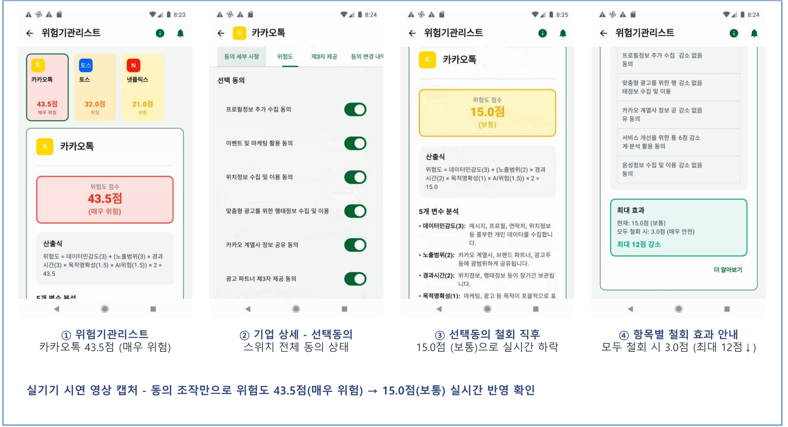
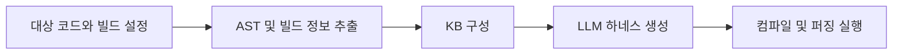
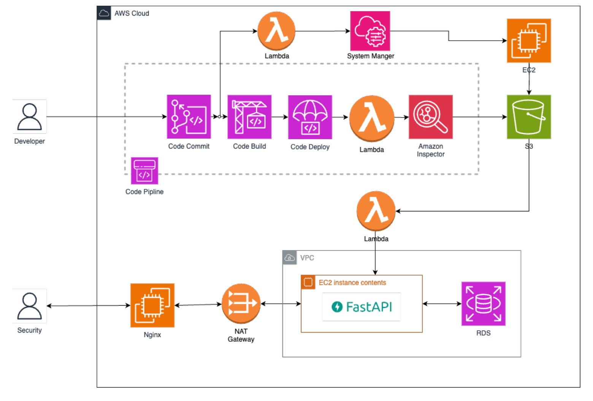
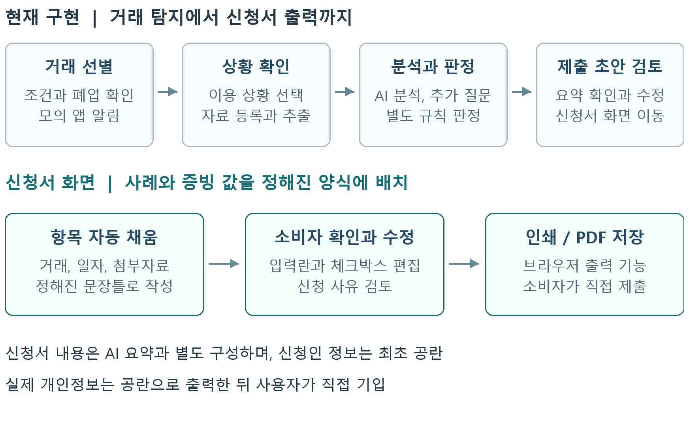

# 신한DS 정보보안 포트폴리오 | 황다연

개인정보 동의 관리 서비스 팀 프로젝트에서 위험도 모델과 동의항목 API를 맡아, 처리방침의 항목과 사용자 선택을 계산 변수로 연결했습니다. C/C++ 퍼징 하네스 자동 생성, 클라우드 SBOM 생성 자동화, 금융 거래 규칙 엔진 프로젝트에서는 입력 데이터와 실행 조건을 확인하고 API와 자동화 기능을 구현했습니다.

정보보호학과에서 공부하며 개인정보보호를 복수전공했고, 개인정보관리사(CPPG)를 취득했습니다.

[상세 포트폴리오 PDF 보기 (8쪽)](portfolio.pdf)

## 목차

- [1. 동의ON - 개인정보 위험도와 동의 선택을 API로 구현](#project-1)
- [2. LogosFuzz - 퍼저에 연결할 C/C++ 하네스 자동 생성 시스템](#project-2)
- [3. 클라우드 SBOM/SCA 자동화 - 저장소 입력과 분석 실행을 연결](#project-3)
- [4. nodown - 금융 거래의 조건 충족과 추가 확인을 구분](#project-4)
- [5. 마이데이터 합성데이터 전환 - 보유기간 만료 이후의 활용 검토](#project-5)
- [6. AI 공급망 명세 작업](#project-8)
- [7. vCAN 차량 네트워크 보안 훈련장 - 정상 통신 API와 CSV 기록](#project-9)
- [8. 개인정보 정책과 AI 권한을 다룬 경험](#project-6)
- [9. 개인 분석과 보안 실습](#project-7)

## 프로젝트 한눈에 보기

| 프로젝트 | 기간과 구성 | 맡은 일 |
|---|---|---|
| 동의ON | 2025.03.11\~2026.08.31 / 4인 팀장 | 개인정보 위험도 모델, 동의항목 API, 회귀 테스트 |
| LogosFuzz | 2026.04\~진행 중 / 4인 | 팀 구성과 참여 제안, AST와 빌드 정보 추출, KB와 하네스 생성 연결 |
| SBOM/SCA 자동화 | 2024.05.04\~2024.07.14 / 팀 프로젝트 | SSM과 Lambda를 이용한 SBOM 생성 자동화, 저장소 주소 전달 |
| nodown | 2026.08.14\~2026.09.06 / 4인 팀장 | 거래 탐지, 가맹점 모의조회, 사례 API, 기본요건 규칙 엔진 |
| 합성데이터 전환 | 2025.07.29\~2025.09.19 / 3인 팀원 | 정책과 기술 요구사항 정리, 합성데이터 전환 PoC 검증 |
| vCAN 차량 보안 훈련장 | 2025.12\~2026.02 / 5인 | 정상 CAN 송수신 API, CSV 생성 및 저장 |

## 1. 동의ON - 개인정보 위험도와 동의 선택을 API로 구현

**기간:** 2025.03.11\~2026.08.31 / **구성:** 4인, 팀장 / **주요 환경:** Java, Spring Boot, MySQL, AWS EC2, OpenAI API

### 프로젝트 소개

길고 복잡한 개인정보처리방침은 이용자가 동의한 정보의 민감도와 제공 범위, 보유기간을 파악하기 어렵게 만듭니다. 동의ON은 처리방침을 구조화해 앱별 위험도와 경고를 보여주고, 동의 변경과 이력 확인을 지원하는 서비스입니다. 팀은 처리방침 수집과 LLM 파싱, 위험도 계산, Android 경고 화면, 자체 DB와 API를 통한 이력 조회를 연결했습니다.

### 맡은 일

팀장으로 일정과 요구사항을 조율하고 위험도 모델과 동의항목 API를 맡았습니다. 데이터 민감도, 외부 제공, 보유기간, 처리 목적, AI 활용을 변수로 정리하고 `DS + (ES × TF × PC × AI) × 2` 산식을 설계했습니다.

동의항목 조회에서는 기업별 필수 및 선택 항목만 나열하는 것으로 충분하지 않아 사용자의 실제 선택 여부와 계산에 사용하는 변수 값을 함께 반환하도록 구현했습니다. 처리방침의 항목, 사용자 선택, 위험도 계산에 들어가는 값이 API에서 어떻게 연결되는지 확인할 수 있도록 구성했습니다.

### 계산 방식과 데이터 형식 통일

모듈을 연결하는 과정에서 숫자 저장 형식과 등급 매핑 기준을 점검했습니다. BigDecimal 변환 헬퍼와 등급 매핑 계약을 정리하고 통합 가이드에 반영했습니다. 프론트의 변수별 최댓값 산출과 공용 모델의 항목별 점수 최댓값 산출 방식이 서로 다르다는 점도 검토 문서에 남겼습니다. 이후 개인 맞춤 위험도의 대표값 계산을 항목별 점수의 최댓값에서 변수별 최댓값 합성 방식으로 바꾸고, 두 방식의 결과 차이와 예외 입력을 회귀 테스트로 확인했습니다.

산출식과 등급 경계뿐 아니라 LLM 응답 파싱, 저장 변환을 포함한 회귀 테스트를 추가했습니다. 동의항목 조회 서비스는 사용자의 선택 상태와 반환 값이 맞는지 별도로 검증했습니다.

**코드:** [동의ON 개발 브랜치 (`develop`)](https://github.com/dayeon053/dynamic-consent-system/tree/develop)

동의ON 팀 서비스 시연 - 담당: 위험도 모델과 동의항목 API. 화면의 위험도는 프로젝트 자체 모델의 시연값입니다.

## 2. LogosFuzz - 퍼저에 연결할 C/C++ 하네스 자동 생성 시스템

**기간:** 2026.04\~진행 중 / **구성:** 4인 / **역할:** 팀 구성과 참여 제안, AST, 빌드 정보, KB 연결 / **주요 환경:** Python, C/C++, Clang/LLVM, Docker, libFuzzer

### 프로젝트 소개

퍼징은 입력을 바꾸며 프로그램을 실행해 비정상 동작을 찾는 테스트입니다. 대상 API를 퍼저에서 실행하려면 호출에 필요한 준비 과정과 의존성을 담은 하네스가 필요합니다. C/C++ 소프트웨어에서는 API 선언뿐 아니라 헤더, 컴파일 옵션, 빌드 조건이 맞아야 하네스를 컴파일하고 실행할 수 있습니다.

LogosFuzz는 API 지식 추출과 LLM을 연결해 하네스 생성, 수정, 검증을 자동화하는 팀 프로젝트입니다. PromptFuzz와 Locus의 하네스 생성 및 프롬프트 전략을 비교하고, 추출한 API 정보와 빌드 정보를 생성 과정에 제공하는 작업을 맡았습니다. 팀은 libFuzzer, AFL++, AFLNet을 활용했습니다.

### API 정보와 빌드 조건 연결

Bazel의 XML 빌드 정보와 Clang AST 분석 결과를 지식베이스에 연결했습니다. API가 반환하거나 전달하는 오류 정보를 추출하고, 헤더와 컴파일 옵션을 하네스 생성기의 수정 힌트로 전달했습니다.

CMake 대상에서도 파일마다 필요한 컴파일 옵션을 읽을 수 있도록 `compile_commands.json` 기반 플래그 추출을 추가했습니다. 대상 프로필, AST 추출기, KB 구성과 하네스 계획을 연결해 비-Bazel 빌드로 적용 범위를 넓혔습니다.

### 컴파일 옵션 누락 수정

평가용 정답셋을 만드는 경로에서 컴파일 플래그가 빠지는 문제를 확인했습니다. 대상 코드가 실제로 사용하는 빌드 옵션과 평가 과정의 옵션이 달라지면 추출 결과를 같은 조건으로 비교하기 어렵습니다. 플래그 전달 경로를 수정하고 KB 빌드와 하네스 계획이 연결되는지 함께 확인했습니다.

WSL의 libsndfile 1.2.2를 대상으로 92개 파일의 빌드 정보를 추출하고 컴파일했습니다. 최소 하네스를 200 runs 실행해 정상 종료를 확인하고 선정한 API 8개의 추출 결과를 소스 정의와 컴파일 심볼로 만든 정답셋에 대조했습니다. 빌드 정보 추출부터 KB 구성, 하네스 생성과 실행까지 이어지는 기능을 점검했습니다.

**코드:** [LogosFuzz 개발 브랜치 (`feature/generic-embedded`)](https://github.com/sesezz/LogosFuzz/tree/feature/generic-embedded)

## 3. 클라우드 SBOM/SCA 자동화 - 저장소 입력과 분석 실행을 연결

**기간:** 2024.05.04\~2024.07.14 / **구성:** 화이트햇스쿨 2기 팀 프로젝트 / **주요 환경:** AWS CodeCommit, S3, Lambda, SSM, EC2, Inspector, cdxgen

### 프로젝트 소개

팀은 애플리케이션의 라이브러리 분석과 서버 패키지 분석을 연결하는 클라우드 SCA 파이프라인을 개발했습니다. 미사용 라이브러리까지 취약점으로 표시되는 문제와 애플리케이션, 서버 분석이 나뉘는 문제를 다뤘습니다. SSM Run Command와 Lambda를 활용한 SBOM 생성 자동화와 CodeCommit 저장소 주소의 S3 전달을 맡았습니다.

### 구현한 흐름

분석 대상 저장소 입력을 Lambda와 SSM, EC2 실행으로 연결하고 생성한 SBOM, JSON 산출물을 S3로 전달하는 흐름을 구성했습니다. 생성한 구성요소 목록을 다음 분석 단계에서 읽을 수 있도록 저장 위치와 전달 방식을 맞췄습니다.

Amazon Inspector 실습을 보조하고 Maven의 Package URL을 조사했습니다. cdxgen과 포매터를 활용한 Maven PURL, SBOM 비교에도 참여해 구성요소를 식별하는 값과 생성 결과를 대조했습니다.

### 분석 시나리오 시연

팀은 저장소 입력부터 SBOM 생성, 서버 패키지 진단, 취약점 조회까지 이어지는 자동 분석 시나리오를 시연했습니다.

**코드:** [SBOM 생성 및 DB 연계 저장소](https://github.com/WhiteHatSchool/SBOM_Gen_and_Conn_DB)

팀 전체 서비스 구조 - 담당: SSM/Lambda SBOM 생성 자동화와 CodeCommit 저장소 주소 전달

## 4. nodown - 금융 거래의 조건 충족과 추가 확인을 구분

**기간:** 2026.08.14\~2026.09.06 / **구성:** 4인 팀장 / **주요 환경:** Python, Flask, REST API, JSON, pytest

### 프로젝트 소개

장기할부 서비스가 중단되면 이용자는 자신의 거래가 어떤 조건에 해당하는지 확인하고 증빙과 신청자료를 준비해야 합니다. nodown은 피해 가능 거래를 선별하고 할부항변 준비를 지원하는 프로토타입입니다. 팀은 정형 규칙에 따른 판단과 생성형 AI의 설명을 구분하고 증빙 분석 및 신청자료 준비 흐름을 설계했습니다.

### 거래 필터와 규칙 엔진

거래 탐지, 가맹점 상태 모의조회, 사례 생성 API와 기본요건 규칙 엔진을 맡았습니다. 금액, 할부기간, 잔여금, 업종으로 거래를 필터링하고 가맹점 상태 정보를 연결했습니다.

규칙 엔진은 9개 조건을 충족, 미충족, 추가 확인 필요로 구분합니다. 입력이 빠졌을 때 조건을 충족했다고 가정하지 않고 확인이 필요한 상태를 반환하도록 했습니다. 제외되는 거래에는 결과와 함께 제외 사유를 표시했습니다.

### 합성 거래로 조건별 결과 확인

프로젝트의 합성 거래 시나리오에서는 12건 가운데 기본조건을 충족한 7건과 폐업 알림 대상 4건을 선별하고 제외 사유를 확인했습니다.

전체 조건을 충족하는 거래, 정보가 누락된 거래, 정상 영업 중인 가맹점과 확장조건을 나누어 규칙을 테스트했습니다. 가맹점 상태는 모의조회로 구성하고 화면에는 카드사가 최종 판단한다는 안내를 표시했습니다.

**코드:** [nodown 저장소 (`main`)](https://github.com/10502R/nodown/tree/main), [규칙 엔진](https://github.com/10502R/nodown/blob/main/services/rule_service.py)

팀 서비스 이용 흐름 - 담당: 거래 탐지, 가맹점 상태 모의조회, 사례 API와 기본요건 규칙 엔진

## 5. 마이데이터 합성데이터 전환 - 보유기간 만료 이후의 활용 검토

**기간:** 2025.07.29\~2025.09.19 / **구성:** 3인, 팀원 / **주요 환경:** Python, SDV(CTGAN), Streamlit, SQLite

원본 마이데이터의 보유기간이 끝난 뒤 데이터 활용이 중단되는 문제를 다룬 프로젝트입니다. 정책과 기술 요구사항을 정리하고 모델 비교, 합성데이터 전환, 운영 통제를 검증하는 PoC 구성에 참여했습니다.

팀은 원본 로드, 유효기간 검증, 합성데이터 생성, KS-test 품질 검증, SQLite 저장과 만료 처리로 이어지는 흐름을 구성했습니다. 보고서에서는 SDV, CTGAN, TabDDPM을 비교했고 코드에서는 CTGAN을 구현했습니다.

PoC에서는 합성데이터의 분포뿐 아니라 감사 및 시스템 로그, 유통기한과 운영 전환 시나리오를 함께 검토했습니다. RBAC를 적용하는 권한 구조도 설계 단계에서 살폈습니다.

## 6. AI 공급망 명세 작업

2026.03.26\~2026.06.04, 3인 AIBOMBOMBass 프로젝트에서 Part A와 모듈 통합을 맡았습니다. Hugging Face 모델 메타데이터를 수집하고 `requirements.txt`, `config.json`, model card의 의존성을 파싱해 SPDX 3.0.1을 참고한 모델 구성명세를 생성하는 작업입니다.

API 실패 시 규칙 기반 대체 경로와 A/B/C 모듈 통합을 담당했습니다. 작성한 모듈은 main 병합 전 단계입니다.

## 7. vCAN 차량 네트워크 보안 훈련장 - 정상 통신 API와 CSV 기록

**기간:** 2025.12\~2026.02 / **구성:** 5인 / **주요 환경:** Python, Flask, vCAN, python-can

차량 네트워크의 정상 통신과 공격 및 탐지 과정을 다루는 팀 프로젝트에서 정상 CAN 송수신 API와 CSV 생성 및 저장을 맡았습니다. 가상 CAN 환경에서 메시지를 주고받고 통신 내용을 기록하는 기능을 구성했습니다.

`can_api.py`의 송신과 수신 API를 작성하고 CSV 저장 라우트를 정리했습니다. 팀은 이후 기능을 하나의 `app.py`로 통합했습니다.

## 8. 개인정보 정책과 AI 권한을 다룬 경험

### INCOGNITO - AI 행위별 권한과 실행 전 승인 기획

AI 에이전트가 개인정보를 읽거나 외부로 보내고 삭제하는 권한을 사용자가 관리하는 주제를 제안했습니다. 읽기, 요약, 전송, 삭제, 외부 입력을 구분하고 민감한 실행은 사용자가 최종 승인하도록 기획했습니다. 접근과 전송 시도를 타임라인에 남기고 외부 전송 직전 정책 검사 결과에 따라 마스킹하거나 요약본으로 바꾸는 방안도 정리했습니다.

개인 기획을 팀원의 민감대화 보호 아이디어와 함께 검토해 통합안을 구상했습니다. 팀은 2026.05.09 우수상을 받았습니다.

### 카드 개인정보유출 판례 - 보호조치 의무와 이행 확인

2025.05\~06, 4인 팀장으로 2013 KB국민카드 고객정보 유출 사건의 판례와 행정처분을 분석했습니다. 위탁 감독, 암호화, 접근통제 의무를 검토하고 원고, 피고 및 개인정보처리자, 규제기관의 쟁점을 비교해 발표했습니다. 심급별 판단을 정리하면서 보호조치를 지시하는 것과 실제 이행 여부를 확인하는 것을 구분해 살폈습니다.

### 처리방침 이용자 평가와 개인정보 불법유통 모니터링

2025년 7월 개인정보 처리방침 이용자 평가단으로 가독성, 이해도와 접근성을 평가했고 개인정보보호위원회 감사장을 받았습니다. 이용자가 처리방침을 이해하고 필요한 내용을 찾을 수 있는지 살펴본 활동입니다.

2026년 7월부터 개인정보 불법유통 대응 대학생 모니터링단에서 온라인 게시물을 모니터링하고 신고하는 활동을 이어가고 있습니다.

## 9. 개인 분석과 보안 실습

### Windows 악성코드 개인 분석

개인 과제에서 이뮤니티디버거와 Windows API 분석을 활용해 Windows PE의 행위를 확인했습니다. API와 로그를 대조하면서 분석 도구를 감지하는 동작과 예약작업을 통한 지속성, C2 통신 행위를 분석했습니다. XOR, Base64, RC4로 처리된 내용을 복호화하며 프로그램의 동작을 확인했습니다.

### 금융보안아카데미 개인 CTF

2025.07.08\~2025.11.07 금융보안아카데미에서 디지털 포렌식, 악성코드 분석, 침해사고 대응 실습을 이수했습니다. 개인 CTF의 Shrinkage 문제에서는 RLE와 역BWT를 이용한 Python 복원 과정을 작성하고 응답을 확인했습니다. Big Echo에서는 입력 처리와 세션 인증 조건을 응답에 대조했습니다.

### 가짜 금융 앱 정적 분석

2025.05.27\~2025.08.23, 6인 팀을 구성하고 악성 APK 분석 및 공모전 자료 공동 작성에 참여했습니다. Python과 apkutils를 이용한 경량 정적 분석 실험에서 VirusTotal 결과를 교차 확인했습니다.

### 소학회 스터디와 CTF 문제 제작

2023.09\~2026.08 정보보호 소학회에서 리버싱, 웹 해킹, 시스템 해킹 스터디를 개설하고 운영했습니다. 2026.01\~03에는 4인 테마형 CTF 프로젝트에서 Web, Forensics 문제의 시나리오, 로그 데이터와 풀이를 제작했습니다.

IPS 실습에서는 4인 팀으로 Suricata, hping3와 Linux를 사용해 SYN Flooding 탐지 룰과 차단을 실습했습니다.
