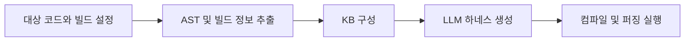

# 신한DS 정보보안 포트폴리오 | 황다연

개인정보 동의 관리 서비스를 개발하고, 개인정보 처리와 권한에 관한 요구사항을 API와 검증 항목으로 구체화했습니다. C/C++ 퍼징 하네스 자동 생성, 클라우드 SBOM 생성 자동화, 금융 거래 규칙 엔진 프로젝트에서는 분석에 필요한 입력과 실행 조건을 확인하고 결과의 근거를 남기는 일을 맡았습니다.

정보보호학과에서 공부하며 개인정보보호를 복수전공했고, 개인정보관리사(CPPG)를 취득했습니다.

## 목차

- [1. 동의ON - 개인정보 위험도와 동의 선택을 API로 구현](#project-1)
- [2. LogosFuzz - 퍼저에 연결할 C/C++ 하네스 자동 생성 시스템](#project-2)
- [3. 클라우드 SBOM/SCA 자동화 - 저장소 입력과 분석 실행을 연결](#project-3)
- [4. nodown - 금융 거래의 조건 충족과 추가 확인을 구분](#project-4)
- [5. 마이데이터 합성데이터 전환 - 보유기간 만료 이후의 활용 검토](#project-5)
- [6. 개인정보 정책과 AI 권한을 다룬 경험](#project-6)
- [7. 개인 분석과 보안 실습](#project-7)
- [8. AI 공급망 명세 작업](#project-8)
- [9. vCAN 차량 네트워크 보안 훈련장 - 정상 통신 API와 CSV 기록](#project-9)

## 프로젝트 한눈에 보기

| 프로젝트 | 기간과 구성 | 개인 담당 | 주요 확인 자료 |
|---|---|---|---|
| 동의ON | 2025.03.11~2026.08.31 / 4인 팀장 | 개인정보 위험도 모델, 동의항목 API, 회귀 검증 | 병합 PR #20, #21, 모델 28개 및 조회 서비스 3개 테스트 기록 |
| LogosFuzz | 2026.04~진행 중 / 4인 | 팀 구성과 참여 제안, AST, 빌드 정보 추출, KB와 하네스 생성 연결 | 병합 PR #71, #76, libsndfile 실행, 평가 기록 |
| SBOM/SCA 자동화 | 2024.05.04~2024.07.14 / 6인 | SSM, Lambda SBOM 생성 자동화, 저장소 주소 전달 | 저장소 입력부터 분석까지 팀 시연 |
| nodown | 2026.08.14~2026.09.06 / 4인 팀장 | 거래 탐지, 가맹점 모의조회, 사례 API, 기본요건 규칙 엔진 | 공개 구현 코드, 담당 지침과 규칙 테스트 |
| 합성데이터 전환 | 2025.07.29~2025.09.19 / 3인 팀원 | 정책, 기술 요구사항 정리, PoC 검증 참여 | CTGAN 구현과 KS-test, 운영 전환 시나리오 |
| vCAN 차량 보안 훈련장 | 2025.12~2026.02 / 5인 | 정상 CAN 송수신 API, CSV 생성 및 저장 | 개인 역할표, 송수신 및 저장 API 코드 |

## 1. 동의ON - 개인정보 위험도와 동의 선택을 API로 구현

**기간:** 2025.03.11~2026.08.31 / **구성:** 4인, 팀장 / **주요 환경:** Java, Spring Boot, MySQL, AWS EC2, OpenAI API

### 해결하려던 문제

길고 복잡한 개인정보처리방침은 이용자가 동의한 정보의 민감도와 제공 범위, 보유기간을 파악하기 어렵게 만듭니다. 동의ON은 처리방침을 구조화해 앱별 위험도와 경고를 보여주고, 동의 변경과 이력 확인을 지원하는 서비스입니다. 팀은 처리방침 수집과 LLM 파싱, 위험도 계산, Android 경고 화면, 자체 DB와 API를 통한 이력 조회를 연결했습니다.

### 담당한 설계와 구현

팀장으로 일정과 요구사항을 조율하고 위험도 모델과 동의항목 API를 맡았습니다. 데이터 민감도, 외부 제공, 보유기간, 처리 목적, AI 활용을 변수로 정리하고 `DS + (ES × TF × PC × AI) × 2` 산식을 설계했습니다. 위험도 모델은 프로젝트에서 정의한 계산 기준이며 법적 위험도를 확정하는 지표로 사용하지 않았습니다.

동의항목 조회에서는 기업별 필수 및 선택 항목만 나열하는 것으로 충분하지 않아 사용자의 실제 선택 여부와 계산에 사용하는 변수 값을 함께 반환하도록 구현했습니다. 처리방침의 항목, 사용자 선택, 위험도 계산에 들어가는 값이 API에서 어떻게 연결되는지 확인할 수 있도록 구성했습니다.

### 통합 과정에서 확인한 문제와 조치

모듈을 연결하는 과정에서 숫자 저장 형식과 등급 매핑 기준을 점검했습니다. BigDecimal 변환 헬퍼와 등급 매핑 계약을 정리하고 통합 가이드에 반영했습니다. 프론트의 변수별 최댓값 산출과 공용 모델의 항목별 점수 최댓값 산출 방식이 서로 다르다는 점도 검토 문서에 남겼습니다. 개인 맞춤 위험도 서버 구현은 완료 범위에 포함되지 않습니다.

산출식과 등급 경계뿐 아니라 LLM 응답 파싱, 저장 변환을 포함한 회귀 테스트를 추가했습니다. 동의항목 조회 서비스는 사용자의 선택 상태와 반환 값이 맞는지 별도로 검증했습니다. 모델의 계산 결과와 서비스의 조회 동작을 나누어 확인한 작업입니다.

### 결과와 검증 범위

- PR #20에는 공용 모델 28개 테스트 통과 기록이 있습니다. 별도 backend `contextLoads`의 기존 실패는 남아 있었습니다.
- PR #21에는 필수 및 선택 동의항목 조회와 사용자 선택 여부를 다루는 서비스 테스트 3개 통과 기록이 있습니다.
- 두 PR은 `develop`에 병합됐습니다. 테스트 수치는 해당 PR의 실행 기록입니다.
- 사용자 실험은 팀원 4명이 공동 수행했고 통계 집계는 다른 팀원이 담당했습니다. 논문은 수정 후 재심 상태입니다.

구현 범위는 자체 DB와 API에서 동의 정보를 조회하고 관리하는 흐름입니다. 외부 서비스의 동의 일괄 철회와 법규 준수 인증은 검증 범위에 포함되지 않습니다.

**코드와 검증 기록:** [회귀 테스트, 타입 변환 PR #20](https://github.com/dayeon053/dynamic-consent-system/pull/20), [동의항목 조회 API PR #21](https://github.com/dayeon053/dynamic-consent-system/pull/21), [개발 브랜치](https://github.com/dayeon053/dynamic-consent-system/tree/develop)

## 2. LogosFuzz - 퍼저에 연결할 C/C++ 하네스 자동 생성 시스템

**기간:** 2026.04~진행 중 / **구성:** 4인 / **개인 역할:** 팀 구성과 참여 제안, AST, 빌드 정보, KB 연결 / **주요 환경:** Python, C/C++, Clang/LLVM, Docker, libFuzzer

### 해결하려던 문제

퍼징은 입력을 바꾸며 프로그램을 실행해 비정상 동작을 찾는 테스트입니다. 대상 API를 퍼저에서 실행하려면 호출에 필요한 준비 과정과 의존성을 담은 하네스가 필요합니다. C/C++ 소프트웨어에서는 API 선언뿐 아니라 헤더, 컴파일 옵션, 빌드 조건이 맞아야 하네스를 컴파일하고 실행할 수 있습니다.

LogosFuzz는 API 지식 추출과 LLM을 연결해 하네스 생성, 수정, 검증을 자동화하는 팀 프로젝트입니다. PromptFuzz와 Locus의 하네스 생성 및 프롬프트 전략을 비교하고, 추출한 API 정보와 빌드 정보를 생성 과정에 제공하는 작업을 맡았습니다. 프로젝트에서 활용한 퍼징 도구에는 libFuzzer, AFL++, AFLNet이 포함됩니다.

### 처리 흐름

### 개인 담당과 구현

Bazel의 XML 빌드 정보와 Clang AST 분석 결과를 지식베이스에 연결했습니다. 생성기가 참고할 API 정보에 실제 빌드 조건을 함께 제공하고, 오류 계약과 컴파일 복구 힌트를 구현했습니다.

CMake 대상에서도 파일마다 필요한 컴파일 옵션을 읽을 수 있도록 `compile_commands.json` 기반 플래그 추출을 추가했습니다. 대상 프로필, AST 추출기, KB 구성과 하네스 계획을 연결해 비-Bazel 빌드로 적용 범위를 넓혔습니다. 개인 담당 범위는 추출과 연결, 컴파일 조건 및 관련 검증입니다.

### 문제를 찾아 수정한 과정

평가용 정답셋을 만드는 경로에서 컴파일 플래그가 빠지는 문제를 확인했습니다. 대상 코드가 실제로 사용하는 빌드 옵션과 평가 과정의 옵션이 달라지면 추출 결과를 같은 조건으로 비교하기 어렵습니다. 플래그 전달 경로를 수정하고 KB 빌드와 하네스 계획이 연결되는지 함께 확인했습니다.

### 검증 결과와 남은 범위

| 항목 | 확인한 결과 | 해석 범위 |
|---|---|---|
| 실행 환경 | WSL, libsndfile 1.2.2 | 해당 버전과 환경의 실행 기록 |
| 빌드 정보 | 92개 파일 추출, 컴파일 기록 | 전체 C/C++ 라이브러리에 대한 보장은 제외 |
| 최소 하네스 | 200 runs 정상 종료 | 생성 후 실행 가능성 확인 |
| API 대조 | 선정 API 8개 대조 | 선정한 API 평가로 한정 |
| PR #76 전체 테스트 | 1142 passed, 5 skipped, 6 failed | 기존 실패를 포함한 결과 |

PR #71과 #76은 `feature/generic-embedded`에 병합됐습니다. 퍼징 하네스 생성에 필요한 입력과 빌드 조건을 연결하고 제한된 환경에서 실행을 검증했습니다. 평가는 해당 환경의 기능 검증으로 한정했고 기존 퍼저 대비 성능 우위는 검증하지 않았습니다.

**코드와 검증 기록:** [원본 개발 브랜치](https://github.com/sesezz/LogosFuzz/tree/dev), [대상 프로필, 추출기 PR #71](https://github.com/sesezz/LogosFuzz/pull/71), [KB 연결, 평가 PR #76](https://github.com/sesezz/LogosFuzz/pull/76), [실행, 평가 문서](https://github.com/sesezz/LogosFuzz/blob/feature/generic-embedded/docs/GENERIC-A-kb.md)

## 3. 클라우드 SBOM/SCA 자동화 - 저장소 입력과 분석 실행을 연결

**기간:** 2024.05.04~2024.07.14 / **구성:** 화이트햇스쿨 2기 6인 프로젝트 / **주요 환경:** AWS CodeCommit, S3, Lambda, SSM, EC2, Inspector, cdxgen

### 문제와 담당 범위

팀은 애플리케이션의 라이브러리 분석과 서버 패키지 분석을 연결하는 클라우드 SCA 파이프라인을 개발했습니다. 미사용 라이브러리까지 취약점으로 표시되는 문제와 애플리케이션, 서버 분석이 나뉘는 문제를 다뤘습니다. 개인 주담당은 SSM Run Command와 Lambda를 활용한 SBOM 생성 자동화 및 CodeCommit 저장소 주소의 S3 전달이었습니다.

### 구현한 흐름

분석 대상 저장소 입력을 Lambda와 SSM, EC2 실행으로 연결하고 생성한 SBOM, JSON 산출물을 S3로 전달하는 흐름을 구성했습니다. 소프트웨어 구성요소 목록을 생성하는 실행 단계와 결과를 다음 분석 단계에서 사용할 수 있게 전달하는 작업을 맡았습니다.

보조 업무로 Amazon Inspector 연계를 검증하고 Maven의 Package URL을 조사했습니다. cdxgen과 포매터를 활용한 Maven PURL, SBOM 비교에도 참여해 구성요소를 식별하는 값과 생성 결과를 대조했습니다.

### 확인한 결과

팀은 저장소 입력부터 SBOM 생성, 서버 패키지 진단, 취약점 조회까지 이어지는 자동 분석 시나리오를 시연했습니다. 개인 기여는 이 흐름의 실행 자동화와 입력 전달에 있습니다. 검증은 교육 프로젝트의 시연 범위이며 취약점 과탐 감소율과 실제 고객사 운영 적용 결과는 측정하지 않았습니다.

**관련 코드:** [팀 관련 SBOM 생성 및 DB 연계 저장소](https://github.com/WhiteHatSchool/SBOM_Gen_and_Conn_DB)

## 4. nodown - 금융 거래의 조건 충족과 추가 확인을 구분

**기간:** 2026.08.14~2026.09.06 / **구성:** 4인 팀장 / **주요 환경:** Python, Flask, REST API, JSON, pytest

### 해결하려던 문제

장기할부 서비스가 중단되면 이용자는 자신의 거래가 어떤 조건에 해당하는지 확인하고 증빙과 신청자료를 준비해야 합니다. nodown은 피해 가능 거래를 선별하고 할부항변 준비를 지원하는 프로토타입입니다. 팀은 정형 규칙에 따른 판단과 생성형 AI의 설명을 구분하고 증빙 분석 및 신청자료 준비 흐름을 설계했습니다.

### 담당한 처리와 판단 방식

거래 탐지, 가맹점 상태 모의조회, 사례 생성 API와 기본요건 규칙 엔진을 맡았습니다. 금액, 할부기간, 잔여금, 업종으로 거래를 필터링하고 가맹점 상태 정보를 연결했습니다.

규칙 엔진은 9개 조건을 충족, 미충족, 추가 확인 필요로 구분합니다. 입력이 빠졌을 때 조건을 충족했다고 가정하지 않고 확인이 필요한 상태를 반환하도록 했습니다. 제외되는 거래에는 사유를 표시해 이용자가 결과와 근거를 함께 확인할 수 있게 구성했습니다.

### 검증과 제한

프로젝트의 합성 거래 시나리오에서는 12건 가운데 기본조건을 충족한 7건과 폐업 알림 대상 4건을 선별하고 제외 사유를 확인했습니다. 이 수치는 당시 프로토타입의 검증 기록이며 실제 거래 탐지율을 뜻하지 않습니다.

공개 규칙 테스트에는 전체 충족, 정보 누락, 정상영업, 확장조건, 확장조건 누락 사례가 담겨 있습니다. 합성 거래와 가맹점 상태 모의조회를 사용했고 실제 카드사, 국세청 연계는 구현 범위에서 제외했습니다. 서비스는 신청 준비를 돕는 용도이며 최종 판단 주체는 카드사로 표시했습니다.

**코드와 검증 항목:** [규칙 엔진](https://github.com/10502R/nodown/blob/main/services/rule_service.py), [규칙 테스트](https://github.com/10502R/nodown/blob/main/tests/test_rule_service.py), [담당 범위와 구현 지침](https://github.com/10502R/nodown/blob/main/docs/A_%EB%8B%B4%EB%8B%B9_%EA%B5%AC%ED%98%84%EC%A7%80%EC%B9%A8.md)

## 5. 마이데이터 합성데이터 전환 - 보유기간 만료 이후의 활용 검토

**기간:** 2025.07.29~2025.09.19 / **구성:** 3인, 팀원 / **주요 환경:** Python, SDV(CTGAN), Streamlit, SQLite

원본 마이데이터의 보유기간이 끝난 뒤 데이터 활용이 중단되는 문제를 다룬 프로젝트입니다. 정책, 기술 요구사항을 정리하고 모델 비교, 합성데이터 전환, 운영 통제를 검증하는 PoC 구성에 참여했습니다.

팀은 원본 로드, 유효기간 검증, 합성데이터 생성, KS-test 품질 검증, SQLite 저장과 만료 처리로 이어지는 흐름을 구성했습니다. 보고서에서는 SDV, CTGAN, TabDDPM을 비교했고 코드에서는 CTGAN을 구현했습니다. 개인 역할은 요구사항 정리와 합성데이터 전환 및 운영 시나리오 검증 참여입니다.

감사, 시스템 로그와 유통기한, 운영 전환을 포함한 PoC를 검토했습니다. RBAC는 설계 검토 범위로 구분했습니다. 검증 범위는 합성데이터 전환과 분포 비교, 운영 시나리오이며 재식별 위험 제거는 입증하지 않았습니다.

## 6. 개인정보 정책과 AI 권한을 다룬 경험

### INCOGNITO - AI 행위별 권한과 실행 전 승인 기획

AI 에이전트가 개인정보를 읽거나 외부로 보내고 삭제하는 권한을 사용자가 관리하는 주제를 제안했습니다. 읽기, 요약, 전송, 삭제, 외부 입력을 구분하고 민감한 실행은 사용자가 최종 승인하도록 기획했습니다. 접근과 전송 시도를 타임라인에 남기고 외부 전송 직전 정책 검사 결과에 따라 마스킹하거나 요약본으로 바꾸는 방안도 정리했습니다.

개인 기획을 팀원의 민감대화 보호 아이디어와 결합해 통합안을 구상했고 2026.05.09 우수상을 받았습니다. 개인 기여는 행위별 권한, 최종 승인, 실행 이력, 외부 전송 전 검사 기획입니다. 전체 프로토타입 구현이나 탐지 성능 검증은 개인 담당 범위에 포함되지 않습니다.

### 카드 개인정보유출 판례 - 보호조치 의무와 이행 확인

2025.05~06, 4인 팀장으로 2013 KB국민카드 고객정보 유출 사건의 판례와 행정처분을 분석했습니다. 위탁 감독, 암호화, 접근통제 의무를 검토하고 원고, 피고 및 개인정보처리자, 규제기관의 쟁점을 비교해 발표했습니다. 심급별 판단을 정리하면서 보호조치를 지시하는 것과 실제 이행 여부를 확인하는 것을 구분해 살폈습니다.

법령과 판례를 학습하고 발표한 경험으로, 검토 대상은 사건의 판례와 행정처분 자료입니다.

### 처리방침 이용자 평가와 개인정보 불법유통 모니터링

2025년 7월 개인정보 처리방침 이용자 평가단으로 가독성, 이해도와 접근성을 평가했고 개인정보보호위원회 감사장을 받았습니다. 이용자가 처리방침을 이해하고 필요한 내용을 찾을 수 있는지 살펴본 활동입니다.

2026년 7월부터 개인정보 불법유통 대응 대학생 모니터링단에서 온라인 게시물을 모니터링하고 신고하는 활동을 이어가고 있습니다. 정책과 처리방침을 읽는 경험을 실제 이용자에게 노출되는 개인정보 문제를 관찰하는 활동으로 넓혔습니다.

## 7. 개인 분석과 보안 실습

### Windows 악성코드 개인 분석

개인 과제에서 이뮤니티디버거와 Windows API 분석을 활용해 Windows PE의 행위를 확인했습니다. API와 로그를 대조하면서 분석 도구 감지, 예약작업을 통한 지속성, XOR, Base64, RC4 복호화, C2 통신 행위를 분석했습니다.

프로그램이 사용하는 API와 기록된 동작을 연결해 행위를 설명한 개인 분석 과제이며, 실제 운영 환경의 침해사고 대응은 수행 범위에 포함되지 않습니다.

### 금융보안아카데미 개인 CTF

2025.07.08~2025.11.07 금융보안아카데미에서 디지털 포렌식, 악성코드 분석, 침해사고 대응 실습을 이수했습니다. 개인 CTF의 Shrinkage 문제에서는 RLE와 역BWT를 이용한 Python 복원 과정을 작성하고 응답을 확인했습니다. Big Echo에서는 입력 처리와 세션 인증 조건을 응답에 대조했습니다.

풀이 과정에서 AI와 외부 풀이를 참고했으며 복원 과정과 확인한 응답을 기록했습니다.

### 가짜 금융 앱 정적 분석

2025.05.27~2025.08.23, 6인 팀을 구성하고 악성 APK 분석 및 공모전 자료 공동 작성에 참여했습니다. Python과 apkutils를 이용한 경량 정적 분석 실험에서 VirusTotal 결과를 교차 확인했습니다.

### 소학회 스터디와 CTF 문제 제작

2023.09~2026.08 정보보호 소학회에서 리버싱, 웹 해킹, 시스템 해킹 스터디를 개설하고 운영했습니다. 2026.01~03에는 4인 테마형 CTF 프로젝트에서 Web, Forensics 문제의 시나리오, 로그 데이터와 풀이를 제작했습니다.

개인 문제 풀이에 더해 다른 사람이 입력과 로그를 확인하며 접근할 수 있는 실습 문제를 만드는 경험을 쌓았습니다. 별도 IPS 실습에서는 4인 팀으로 Suricata, hping3와 Linux를 사용해 SYN Flooding 탐지 룰과 차단을 실습했습니다.

## 8. AI 공급망 명세 작업

2026.03.26~2026.06.04, 3인 AIBOMBOMBass 프로젝트에서 Part A와 모듈 통합을 맡았습니다. Hugging Face 모델 메타데이터를 수집하고 `requirements.txt`, `config.json`, model card의 의존성을 파싱해 SPDX 3.0.1을 참고한 모델 구성명세를 생성하는 작업입니다.

API 실패 시 규칙 기반 대체 경로와 A/B/C 모듈 통합을 담당했습니다. React 시각화와 OSV 취약점 스캔은 다른 팀원이 맡았습니다. 원본 변경은 main 미병합 상태이며 통합 테스트 완료와 운영 적용은 확인되지 않았습니다.

## 9. vCAN 차량 네트워크 보안 훈련장 - 정상 통신 API와 CSV 기록

**기간:** 2025.12~2026.02 / **구성:** 5인 / **주요 환경:** Python, Flask, vCAN, python-can

차량 네트워크의 정상 통신과 공격 및 탐지 과정을 다루는 팀 프로젝트에서 정상 CAN 송수신 API와 CSV 생성 및 저장을 맡았습니다. 가상 CAN 환경에서 메시지를 주고받고 통신 내용을 기록하는 기능을 구성했습니다.

`can_api.py` 담당 범위에 맞춰 송신과 수신 API를 작성하고, 개발 과정에서 송수신 및 CSV 저장 라우트를 정리했습니다. 팀은 이후 기능을 하나의 `app.py`로 통합했습니다. DoS API, 모델 API, 전체 앱 통합은 다른 팀원이 맡았습니다.

개인 구현 범위는 정상 통신과 기록 기능입니다. 실제 차량 적용이나 공격 탐지 성능 평가는 수행 범위에 포함되지 않습니다.
